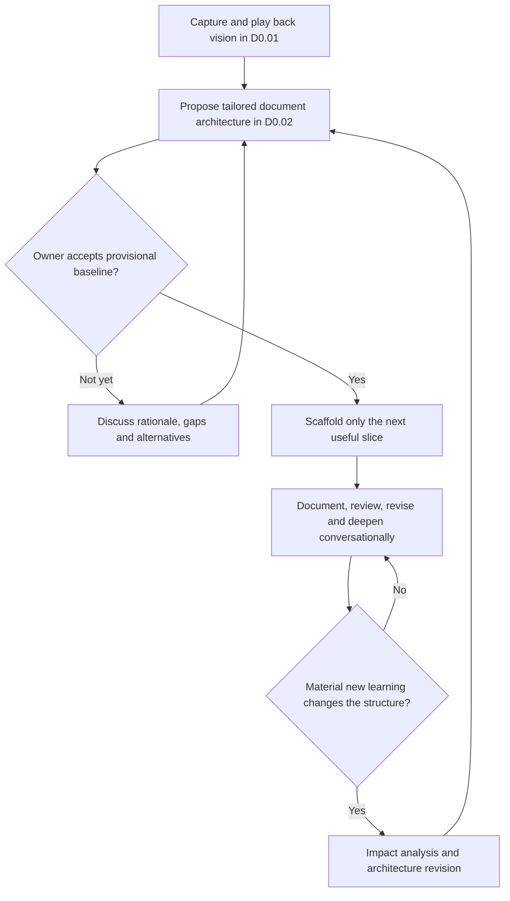

# ADAPTIVE-DOCUMENT-ARCHITECTURE.md — Mandatory Phase 0 Protocol

## Purpose

Design a documentation system that fits **this project**, rather than forcing the project into a fixed collection of files. The document catalog and phase plan are reusable starting points, not a mandatory final shape.

This protocol is mandatory in P0. The first vision note may be created before the architecture is designed; no broad scaffold or detailed documentation set should be created until a project-specific architecture has been proposed and the owner has accepted it as a **provisional baseline**. This is a small, reviewable agreement—not a demand to know the entire project upfront.

## Core principle: stable governance, adaptive structure

Keep the framework's control principles stable: clear sources of truth, traceability, explicit uncertainty, reviewable changes, honest state, quality checks, and resumable sessions. Adapt the project-specific structure: document groups, names, granularity, templates, dependencies, diagram types, planning depth, and where useful the phase sequence or specialist reviews.

Do not mistake the default catalog for a requirement. Add, split, merge, rename, move, defer, or exclude documents and whole groups when the project warrants it. Every important concern must be covered somewhere; it does not need a standalone file if that would create noise.

## Minimum input before the first proposal

Use whatever is already available in the owner's opening description. Usually this is only:
- what the project broadly is and why it should exist;
- likely primary users or operators, if known;
- expected product/system shape at a high level (for example, web product, API/platform, AI agent, automation, data system, device/embedded system, or a hybrid);
- any immediately visible critical constraint or risk.

Do **not** run an exhaustive intake to fill gaps. Record unknowns and make the first architecture provisional. Ask only a small number of high-impact questions when they materially change the structure.

## Required workflow

### Step 1 — Capture and play back the vision

Create or update `D0.01` from the owner's own words. Separate stated facts, interpretations, proposals, assumptions, and open questions. Invite correction before treating the playback as confirmed.

### Step 2 — Propose a small, tailored documentation architecture

Create or update `D0.02` (`docs/00-overview/documentation-scope.md`) after the first useful playback. The proposal must show enough structure to start work—not every future paragraph or every low-level document detail.

At minimum, define:
1. **Project profile and drivers:** project/system type, intended readers, planning depth, risk/complexity signals, and documentation purpose.
2. **Document groups and proposed tree:** candidate folders, document families, naming conventions, and a short purpose for each group.
3. **Document inventory and applicability:** map the default catalog to `core`, `core-light`, `conditional`, `deferred`, `excluded`, `merged`, `split`, or `new`; give a reason for material inclusions/exclusions. Do not force empty documents merely to preserve catalog symmetry. Keep each disposition explicit and map canonical document IDs to manifest applicability using the rules in the adaptive architecture template.
4. **Phase/sequence fit:** show which phases apply, which should be combined or supplemented, and which conversations may happen early without prematurely approving downstream design.
5. **Source-of-truth and dependency model:** identify canonical owners of key facts, stable-ID families, important document dependencies, and how the manifest will mirror the structure.
6. **Diagram and visual plan:** select useful views for this project (for example: user journey, context, component/container, data flow, sequence, state, deployment, threat boundary, hardware/software boundary, pipeline or evaluation flow). Only plan views that answer real questions.
7. **Quality coverage:** show where requirements, traceability, assumptions, decisions, risks, security/privacy, testing, operations, and delivery concerns will be handled; use a coverage map instead of a standalone file when appropriate.
8. **Evolution rules:** define triggers for adding/splitting/merging/moving documents and how changed structure is kept coherent.
9. **Owner review:** record feedback and whether the architecture is proposed, accepted provisionally, or requires revision.

This architecture is itself documentation. Do not create another parallel source of truth for the same inventory: `D0.02` explains the intended structure; `_control/registry/MANIFEST.md` is the operational inventory; `_framework/DOC-CATALOG.md` holds reusable scaffolding checklists and mappings.

### Step 3 — Review conversationally

Present the architecture in a compact form: proposed groups/tree, the most important tailoring decisions, relevant exclusions, and the key uncertainty that could change the structure. Explain why the structure fits this project. Ask for feedback on the proposed structure—not answers to every future product or technical question.

A provisional architecture may contain explicit conditional branches, such as “create an AI evaluation group if model-based functionality is in scope.” Do not force a decision before evidence is available. Record triggers that would resolve it.

### Step 4 — Accept a provisional baseline and scaffold only the next slice

Once the owner accepts the proposed structure as a reasonable starting point, mark `D0.02` approved in the manifest and front matter, record the decision, and proceed. **Approval means “fit to guide the next iterations,” not “this structure can never change.”**

Create only the documents needed for the next useful conversation. Do not bulk-scaffold the tree by default. Early on, this will usually be `D0.01` and `D0.02`; later, one selected document or a small related set. Continue to use outline → working → detailed maturity. The helper enforces this gate. A deliberate exception requires `--override-architecture-gate --override-reason "<reason>"`; record the reason in D0.02 or the session log. A dry run may preview later documents without creating them.

### Step 5 — Re-evaluate when the project teaches us more

Revisit the architecture when new information reveals a material change, including:
- a new major capability, actor, domain or operating mode;
- a shift in platform, runtime, hardware/software boundary or delivery model;
- a material integration, data sensitivity, regulatory or safety obligation;
- a document becoming hard to review because it contains multiple concerns;
- repeated duplication across documents or unclear ownership of a fact;
- a phase gate requiring a missing evidence type;
- a product pivot or a new implementation/research stream.

Do not rebuild the whole tree for a trivial wording edit. Use impact analysis and revise only the affected parts.

## Adaptive-architecture flow

Do **not** list `D0.02` as a content dependency on every post-bootstrap document. The manifest `Depends on` field models information-flow dependencies only: a document belongs there only when it consumes information from the named source. Structural impact is a separate review-candidate relationship. When `D0.02` changes, `python bp.py impact D0.02` lists active/in-profile documents as candidates without falsifying the content-dependency graph. Inspect the candidates and update only those whose structure, canonical ownership, path, phase, template, dependency, or coverage is actually affected. This distinction keeps the graph meaningful while ensuring architecture changes still trigger a broad review.

## Rules for structural changes

Classify the change as `add`, `split`, `merge`, `rename`, `move`, `resequence`, `exclude`, `restore`, or `phase-adjustment`. Then:
1. Explain the reason and expected benefit; identify affected document IDs and links.
2. Update `D0.02` first when it owns the proposed architecture.
3. Update `_control/registry/MANIFEST.md` (ID, path, phase, applicability/rationale, profile tier, status, maturity, version/date, content dependencies, title), `_framework/DOC-CATALOG.md` (path/title/checklist/template mapping), `_control/WORKSPACE.json` and `_control/PHASES.md` if configured paths or phases change, relevant indexes and `_framework/WORKFLOW-PLAN.md` where needed. The strict checker compares manifest-backed front matter and catalog paths/titles to catch drift.
4. Update helper validation/phase maps if the structure change alters assumptions baked into `_framework/tools/blueprint.py`; do not leave tooling silently out of sync.
5. Preserve IDs when the underlying document remains the same. Never reuse retired IDs; mark retired items superseded/excluded and point to replacements.
6. Update dependency graphs, traceability references, document front matter and `_control/STATE.md`.
7. Run `python bp.py check --strict`, inspect the dependency graph, and review the change impact. Re-render critical diagrams when possible.
8. Record owner approval for meaningful structural changes and add a session/change-log note.

For moved or renamed files, update links and manifest paths in the same change. For a split, create new child IDs and link the former document to the successors. For a merge, preserve the retired records and document which source-of-truth rules moved into the merged file.

## Decision standards

- **Prefer a group** when several documents share a stable domain or reader audience.
- **Prefer separate documents** when concerns have different owners, change rates, audiences, review gates, or traceability needs.
- **Prefer a single document with clear sections** when concerns are small, tightly coupled, and reviewed together.
- **Prefer a repeatable family** for many instances of the same structure (components, APIs, agents/tools, device types, workflows, schemas, experiments).
- **Use conditional artifacts** for genuine branches in scope, and record the condition that activates them.
- **Never omit a critical concern silently.** Every catalog concern must be covered, explicitly not applicable with rationale, or tracked as unresolved/deferred with an owner and revisit trigger.

## Phase 0 exit criteria for adaptive architecture

P0 may pass when all of the following are true:
- `D0.01` contains a useful owner-corrected vision playback at its current maturity.
- `D0.02` has a tailored proposed tree and inventory, not simply the default catalog pasted unchanged.
- The purpose of each initial document group and the source-of-truth/manifest relationship are clear.
- Conditional and excluded items have rationale or explicit decision triggers.
- The owner has explicitly accepted the structure as a provisional baseline.
- Only the required next slice has been scaffolded, unless bulk scaffolding was explicitly requested.
- State, open questions, decisions and handoff reflect the agreement.

P0 does **not** require every product requirement, architecture choice, database field, API, test, or future document body to be known. Those emerge through the remaining conversational planning process.

### Approved inventory-to-manifest conformance

The approved adaptive architecture is the project-specific source for the intended document set; `_control/registry/MANIFEST.md` operationalizes it. `check --strict` compares explicit inventory IDs and dispositions only after the architecture document has a valid owner approval fingerprint. Core/Core-light map to `active`, Conditional to `conditional`, Deferred to `deferred`, and Excluded to `excluded`. Merged source IDs remain excluded and must identify an active host. New mappings require an explicit stable ID and valid manifest applicability. Split mappings use one original ID and at least two child IDs in a directional form (`original → child1, child2`); every referenced ID must have explicit manifest applicability. The validator does not infer whether the original is retired. Before valid approval, discrepancies are advisory. Validation is read-only and never edits the architecture, manifest or dependency graph.
