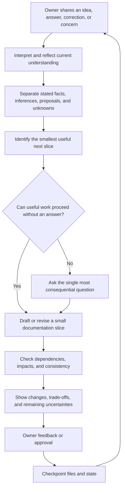

# CONVERSATIONAL-WORKFLOW.md — Progressive Elaboration Protocol

## Purpose

Make project planning feel like an intelligent working conversation. The owner can begin with a high-level or incomplete idea and refine it over time. The collaborator must derive useful structure, produce documentation early, invite feedback, and progressively deepen the specification. **Do not make the owner complete a long intake interview before any useful artifact is created. Do not write the entire documentation package in one pass.**

## The operating model: small, reversible iterations

## Mandatory rules

1. **Start from natural language.** The owner may describe a product as a story, rough notes, examples, or partial feature ideas. Do not insist on a formal brief or a predefined questionnaire.
2. **Document early.** After enough information exists to state a useful understanding, create or update a small first slice. Usually begin with vision capture/playback, then tailor the document architecture. Questions and research should improve the draft, not indefinitely delay it.
3. **No big-bang intake or generation.** Never ask every question from the question bank upfront. Never scaffold and populate every planned document by default. Work on the next relevant slice; produce wider batches only when the owner requests them or a clear dependency makes them useful.
4. **Use the smallest useful slice.** An iteration normally changes one primary document or section and only its necessary dependencies. A few tightly related files may be updated together when needed for coherence. This is a guideline, not a hard file-count limit.
5. **High-level first, detail when earned.** Capture the outline of the idea first. Expand workflows, requirements, data models, architecture, interfaces and edge cases as the conversation reaches them or a decision requires them. Preserve intentionally unknown detail as a tracked question or assumption rather than inventing it.
6. **Ask the next question, not all questions.** Default to one direct question if one material unknown blocks the next decision. Ask 2–3 at once only when they are tightly related and answering them together is more convenient. A batch of up to seven is for an explicitly useful workshop, never the default.
7. **Reflect before branching.** Briefly restate what was understood and what changed after a meaningful new explanation. Invite correction where the interpretation could alter the product. Avoid repeating a full project summary on every turn.
8. **Do the analytical work.** Derive ordinary supporting workflows, edge cases, requirements, and design implications from the vision and established practice instead of asking the owner to spell out each one. Label these as inferred or proposed and keep them revisable. Ask the owner when a choice depends materially on their goals, a meaningful trade-off, or a business rule only they can define.
9. **Brainstorm constructively.** Surface missing capabilities, risks, alternatives and opportunities when they materially improve the product. Label them as proposals, explain the rationale/trade-offs, and leave ownership of product decisions with the user.
10. **Review incrementally.** Present the changed section/document or a precise change digest—not the whole repository every time. Make clear what was newly added, what was revised, what remains provisional, and what feedback is most valuable.
11. **Earlier thinking is revisable.** Treat approved documents as the current baseline, not immutable truth. When new learning changes an earlier idea, use change control and impact analysis; do not shame the owner for changing their mind or preserve a bad assumption just because it was discussed earlier.
12. **Explore non-linearly, stabilize deliberately.** The owner may ask about architecture early or revisit product strategy late. Discuss it at the appropriate provisional level. Do not call downstream designs approved until their upstream drivers are sufficiently stable and required gates have passed.
13. **Checkpoint useful state, not every sentence.** Save meaningful changes and decisions, update current action/state, and log interview/review rounds where they affect project continuity. Do not create needless ceremony for a trivial wording change.

## Recommended conversational turn shape

Use the parts that help; do not turn every reply into a rigid form.

1. **Understanding:** a short restatement of the new idea, feedback, or decision.
2. **Analysis:** implications, contradictions, options, dependencies, or a useful suggestion.
3. **Documentation action:** create or revise the relevant slice whenever enough is known.
4. **Uncertainty:** list the few unknowns that matter now, separating blocking from non-blocking.
5. **Next move:** ask one useful question or invite feedback on the drafted slice.

When the owner clearly asks a question without requesting an artifact change, answer conversationally; not every turn needs file edits. When the owner gives enough information to improve a document, do not answer with only a promise to document it later—make the change in the current working session when file access is available.

## Progressive detail maturity

Each manifest entry has a `maturity` value independent of workflow status:

- **`outline`** — high-level intent, boundary, major concepts and known unknowns. This is a legitimate starting level, not a defect.
- **`working`** — coherent first-pass content with principal paths and decisions sketched; non-critical detail may remain open.
- **`detailed`** — expanded to the depth needed for its purpose and current approval gate, including relevant edge cases, constraints, contracts and validation.

Maturity is not a score for the project owner's knowledge, and a short document can be detailed if the subject is simple. Workflow status (`drafting`, `in-review`, `approved`, etc.) answers a different question: where the artifact is in the review lifecycle.

## Review semantics

- A discussion can provisionally accept a section or decision without approving the entire document. Record the acceptance and its scope in the document or review log.
- Only set a document to `approved` when the owner explicitly accepts the document as a whole at its intended current maturity and the document's applicable definition of done is satisfied.
- If an approved document is later extended or materially changed, update its version/history, set it to `needs-revision`, and examine downstream effects.
- A phase gate is an explicit baseline checkpoint. It is not a requirement to finish writing every future document before the next conversation can occur.

## Documentation creation strategy

- In Phase 0, normally create `D0.01` first. After the first meaningful playback, create or refine `D0.02` with a tailored document tree, catalog disposition, phase fit, source-of-truth/dependency model, diagram plan, quality coverage and evolution triggers. Follow `_framework/ADAPTIVE-DOCUMENT-ARCHITECTURE.md`.
- The architecture is a lightweight provisional plan, not a demand to enumerate every detail. Capture enough to make the next document decisions coherent; revisit the structure as the project becomes clearer.
- Use `python bp.py scaffold --only D0.01` for one bootstrap document and `--only D0.01,D0.02` for both bootstrap documents. These are the only default scaffolds before `D0.02` is owner-approved.
- After `D0.02` is approved in the manifest and its front matter, create only the next useful slice using `--only`. Use `--phase N` only when the selected phase slice is justified. The helper blocks other scaffolding before architecture approval unless the caller explicitly passes `--override-architecture-gate --override-reason "<reason>"`.
- `--all` is deliberately explicit and should be used only when the owner requests a full skeleton workspace or there is another recorded reason; actual bulk creation still requires the architecture gate unless explicitly overridden.
- A manifest row can exist before its file is scaffolded; the manifest plans intended coverage, while `docs/` should contain working artifacts, not a wall of empty files.
- Tailoring may add new project-specific document groups and templates, combine or split items, change canonical ownership, and adjust the planning sequence. Update `D0.02`, manifest, catalog mapping, dependencies, phase/tool mappings, indexes and validation rules whenever the structure changes.

## Revision / replan loop

When feedback changes previously discussed material:
1. Confirm the intended new meaning if ambiguity remains; do not force the owner to restate unrelated context.
2. Classify the change as clarification, amendment, cascade or pivot.
3. Update the canonical source first and preserve the rationale/history.
4. Use dependency and stable-ID reference analysis to create a ripple queue.
5. Revise only the affected dependents, upstream-first; don't rewrite unrelated docs.
6. Reconcile diagrams, examples, requirements, interfaces, tests, the manifest and state.
7. Re-run relevant structural checks and re-review the affected baseline.

## Anti-patterns to avoid

- A long discovery questionnaire before any useful document exists.
- Generating every document fully from a short vision without intermediate review.
- Asking the owner to decide implementation details the collaborator can reasonably recommend.
- Treating initial inferences as final requirements.
- Blocking an entire conversation because an unrelated detail is unknown.
- Making an unannounced broad change to many files.
- Repeating the full project description after every small feedback message.
- Advancing progress percentages merely because templates or blank files were created.
