# DIAGRAMS.md — Mermaid standards and snippets

Version 2.3 note: diagrams are part of the specification, but a valid diagram is not proof that its semantics are correct. At gates, compare each important diagram to its owner documents; render critical diagrams if tooling permits.

All diagrams are **Mermaid** in fenced blocks (` ```mermaid `), embedded in the document they illustrate. They render in GitHub, GitLab, VS Code (Markdown Preview Mermaid Support), JetBrains IDEs, Obsidian and most docs tools.

## 1. Choosing the diagram type

| You need to show… | Use | Typical documents |
|---|---|---|
| Problem space, feature map, hierarchy | `mindmap` | D1.01, D2.02, D4.01 |
| Process, workflow, decision logic, system context/containers/components, deployment, data flow | `flowchart` | D1.04, D2.03, D3.02, D4.02, D4.03, D4.06, D5.04, D6.03 |
| Interactions over time between actors/components | `sequenceDiagram` | D3.03, D4.03, D4.07, D5.04, D5.08 |
| Lifecycle of an entity or component | `stateDiagram-v2` | D2.07, D3.01, D5.03 |
| Entities and relationships (conceptual or physical) | `erDiagram` | D3.01, D5.01 |
| Classes/modules and their relations | `classDiagram` | D4.03, D5.03 |
| User experience over stages | `journey` | D2.01 |
| Schedule, roadmap, rollout | `gantt` | D7.01, D7.07 |
| 2×2 positioning (stakeholders, risks, competitors) | `quadrantChart` | D1.02, D1.05, D1.04 |

Newer types (`architecture-beta`, `block-beta`, `C4Context`, `sankey-beta`, `xychart-beta`) are optional: renderer support varies. Prefer `flowchart` for C4-style views; only use newer types if the user confirms their renderer supports them.

## 2. Rules

1. **One diagram, one message.** Caption it in one sentence above or below. If you can't state its message, split or drop it.
2. **Size limit:** ≤ ~15 nodes (flowchart), ≤ ~8 participants (sequence), ≤ ~12 entities (ER). Larger → layer it (overview + detail diagrams).
3. **Use document vocabulary and IDs** in labels (`CMP-003 Order API`, `ENT-007 Invoice`) so diagrams link to text.
4. **Quote labels** that contain spaces plus punctuation, parentheses, slashes, colons or non-ASCII: `A["Label (detail)"]`.
5. **Direction:** `TB`/`TD` for hierarchies and flows; `LR` for pipelines and layers. Be consistent within a document.
6. **Group with `subgraph`** for boundaries (system, trust zone, environment). Name the boundary.
7. **Show failure and alternate paths** in flows and sequences (`alt`/`opt`/`else`), not only the happy path.
8. **Legend** when using colour or line styles meaningfully. Colour must never be the only carrier of meaning.
9. **Text match:** the diagram and the prose/tables must tell the same story. Update both together.
10. **No orphan diagrams:** each diagram is referenced by the text and appears in the document's checklist.
11. **Complex logic** → also provide a table (decision table, state-transition table). Diagrams complement, not replace, precise specs.

## 3. Syntax pitfalls (avoid rendering errors)

- Don't use the bare word `end` as a node label in flowcharts; write `End` or `"end"`.
- Put `<br/>` for line breaks inside quoted labels; avoid raw newlines in labels.
- Special characters (`(`, `)`, `[`, `]`, `{`, `}`, `:`, `;`, `#`, `"`) in labels → wrap the label in double quotes and replace inner double quotes with `'`.
- Node IDs: letters, digits, underscores; no dots, spaces or hyphens at the start. Use `CMP_003["CMP-003 Order API"]`.
- Every `subgraph` needs a matching `end`; every `alt/opt/loop/par/critical/break/rect` in sequence diagrams needs an `end`.
- `erDiagram` entity names: no spaces (use `UNDER_SCORE`); attribute lines are `type name [PK|FK|UK] ["comment"]`.
- In `sequenceDiagram`, participant aliases with spaces need `participant X as Long name`.
- Comments: `%% text` on their own line.
- `gantt` task names must not contain `:`; always declare `dateFormat`.
- Avoid very long labels (> ~40 chars). Put detail in the table below the diagram.
- If the user's renderer shows an error, simplify: remove styling, shorten labels, split the diagram, then reintroduce.

**Validate** (optional): Prefer a Mermaid renderer that is already installed locally. PBF does not download, install or execute rendering tools automatically. If a renderer is unavailable, explain the missing dependency and obtain explicit owner approval before installing a pinned version from a trusted package source. Do not upload project diagrams, specifications or other project content to an online renderer unless the owner explicitly approves the external disclosure. `python bp.py check` performs only structural sanity checks (known diagram type, balanced `end`s).

## 4. Snippets to copy

### 4.1 System context (C4 level 1) — `flowchart`

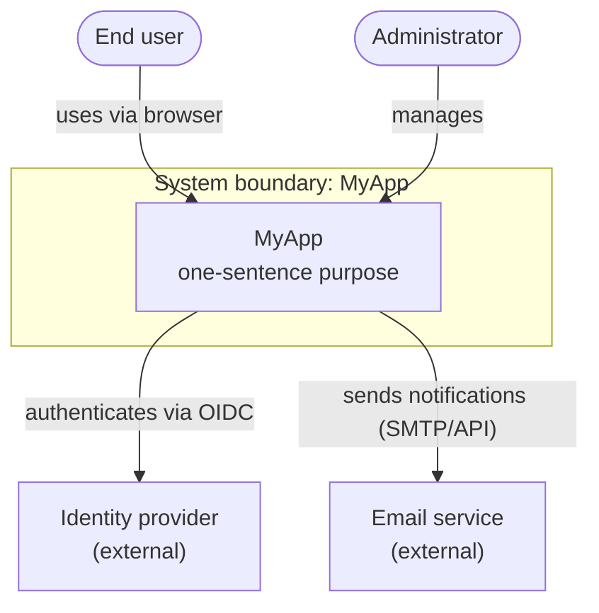

### 4.2 Containers (C4 level 2) with trust boundary

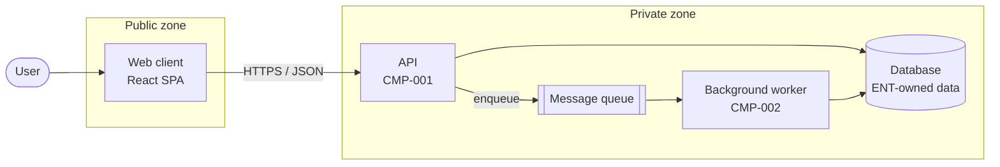

### 4.3 Process / decision flow

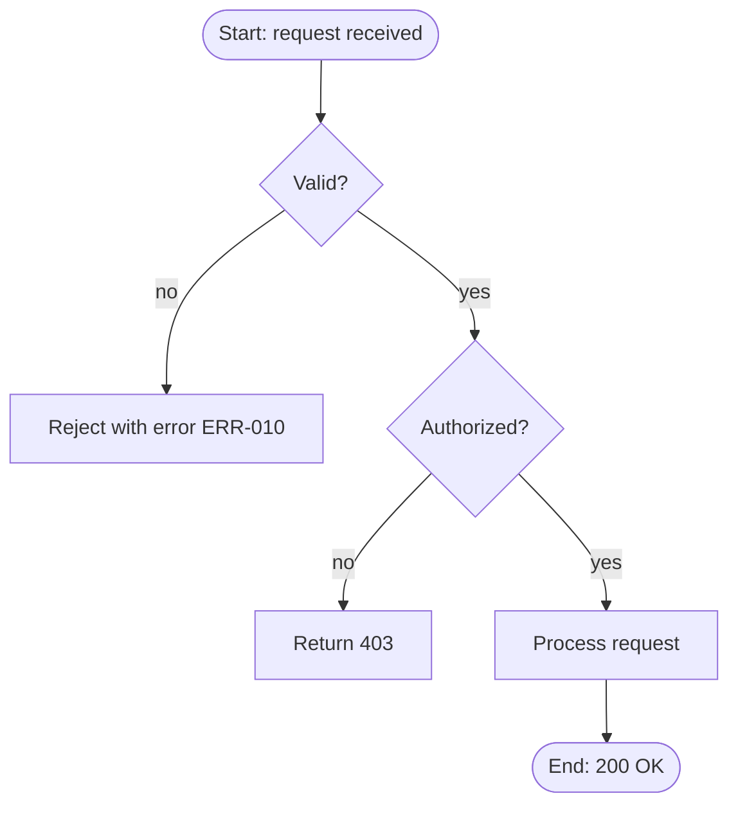

### 4.4 Sequence with alternate path

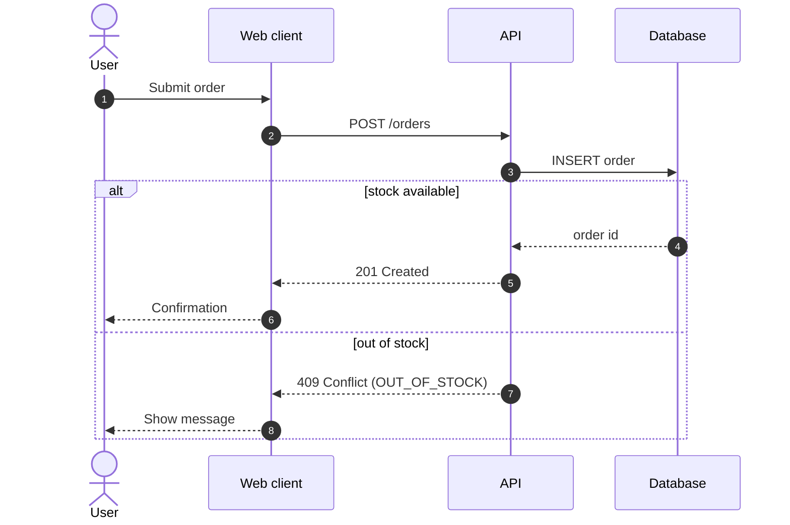

### 4.5 Lifecycle (state machine)

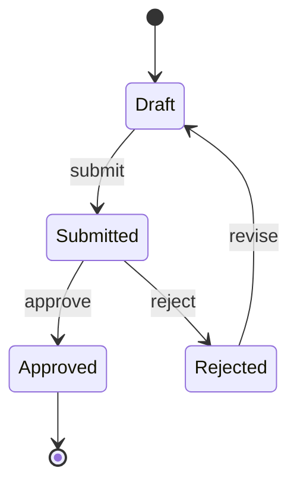

### 4.6 Entity-relationship

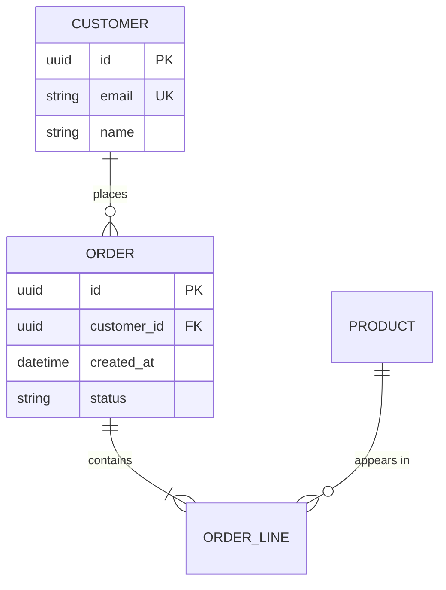

Cardinality: `||` exactly one, `o|` zero or one, `|{` one or many, `o{` zero or many.

### 4.7 Classes / modules

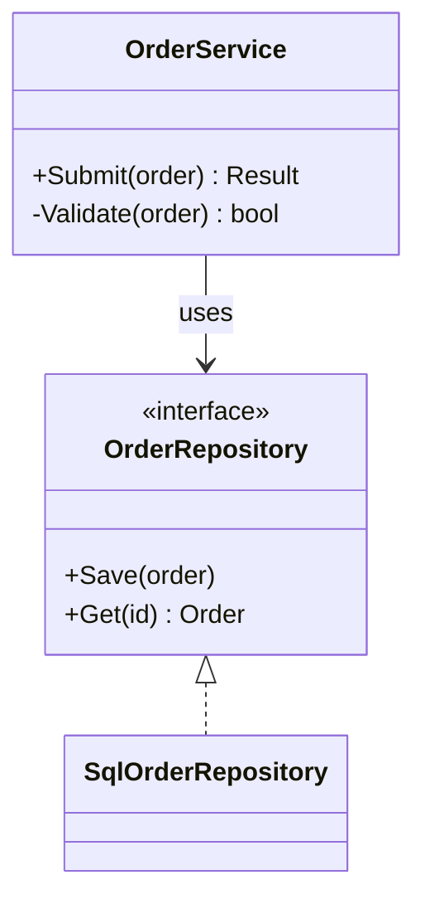

### 4.8 User journey

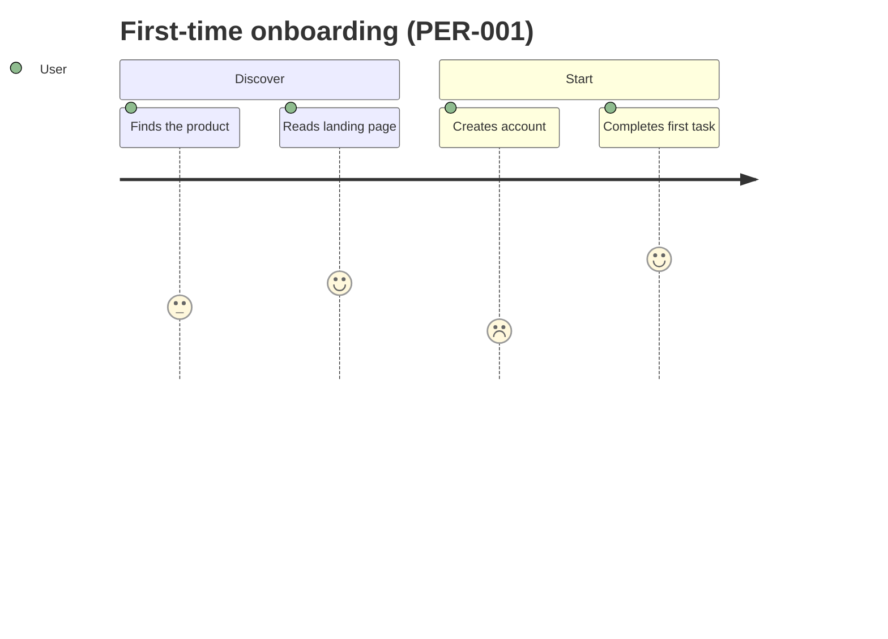

### 4.9 Roadmap

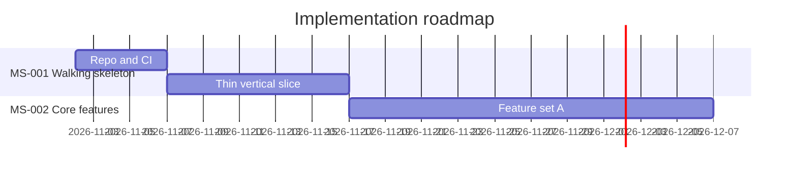

### 4.10 Mind map

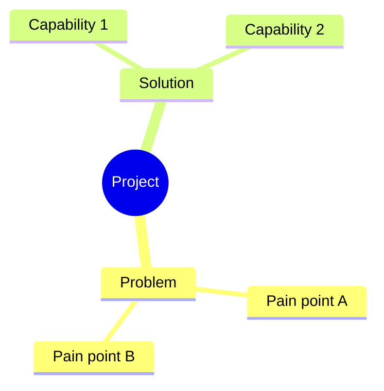

### 4.11 Quadrant chart

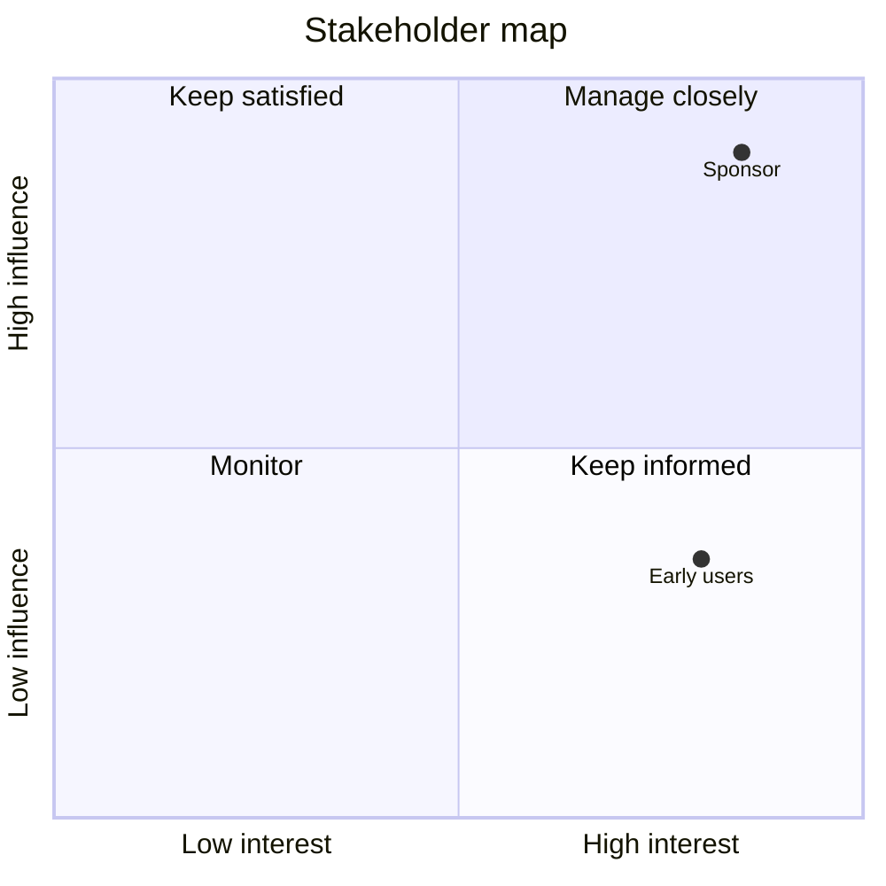

### 4.12 Folder / layer tree (text, not Mermaid)

```text
src/
  Domain/          # entities, rules; no dependencies
  Application/     # use cases; depends on Domain
  Infrastructure/  # DB, HTTP clients; depends on Application
  Web/             # delivery; depends on Application
```

## 5. Documenting a diagram

Under each diagram, add:

> **Figure N — <caption>.** <What to notice in one or two sentences.> Source of truth: <doc/ID>.

## 6. Current document-ID mapping validation

The document IDs above must exist in `_control/registry/MANIFEST.md`. Treat these as illustrative usage pointers only; if the project-specific document architecture merges, splits or renames a group, update this table during structural-impact review. The strict helper checks Markdown links and Mermaid structure throughout the package; it also validates stable project IDs in project artifacts, but does not infer diagram semantics.
