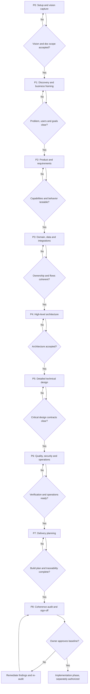

# _framework/WORKFLOW-PLAN.md — Master Exploration and Planning Methodology

## 1. Outcome and definition of done

The objective is a **planning baseline that makes implementation execution, rather than product discovery, the main remaining work**. This does not mean every conceivable detail must be decided in advance: low-impact details can remain delegated if clear rules constrain them. Critical behavior, architecture, data, failure handling, security and operations must not depend on hidden assumptions.

The package is ready when:
- The problem, users, goals, scope, constraints and success measures are accepted.
- In-scope requirements are atomic, sourced, prioritized and verifiable.
- Domain, data ownership, integrations and key workflows are described.
- Significant architecture/design decisions have alternatives, rationale, consequences and validation evidence.
- Critical interfaces, modules, schemas, state transitions, error behavior and operational controls are specified.
- Important requirements trace to implementing elements and tests; gaps are resolved or explicitly accepted.
- Risks and assumptions have owners, validation or mitigation actions, and statuses.
- Automated checks and a semantic coherence audit have run; known limitations are disclosed.
- Each phase gate has an explicit owner decision, and Phase 8 sign-off establishes the planning baseline.
- A build guide tells a new developer or coding agent how to start without needing private chat history.

## 2. Principles

1. **Why → What → Domain → How → Operate → Deliver.** Do not let technology preferences replace discovery.
2. **Map breadth, then work in slices.** Tailor the likely documentation set early, but do not fully outline every file before drafting something useful. Let the structure evolve as project understanding improves.
3. **Ask before assuming.** Use focused interviews. Proposals and assumptions remain labelled until accepted/validated.
4. **Decide late enough, but explicitly.** Do not prematurely lock technical choices; do not leave important choices implicit.
5. **Traceability by construction.** Allocate IDs and source links as concepts appear.
6. **One fact, one canonical home.** Cross-link instead of copying.
7. **Use gates, not calendar dates.** Move phases when exit evidence is sufficient, not because a schedule says so.
8. **Small feedback loops.** Listen → reflect → derive implications → ask the next useful question → draft a small slice → review → revise → checkpoint.
9. **Progressive elaboration.** Documents mature from outline to working draft to detail. Early completeness means accurately representing what is currently known and surfacing unknowns, not pretending everything is already decided.
10. **Reversible planning.** Earlier choices can change as understanding improves. Use controlled impact analysis rather than treating initial discussions as irrevocable.
11. **No big-bang documentation.** Scaffold and populate only the next useful slice by default; the complete manifest can plan future files without generating every empty skeleton at once.
12. **Risk-proportionate depth.** Security-critical, data-intensive, externally integrated or AI-enabled domains warrant more detail and validation.
13. **Change control is part of design.** An upstream change must identify and revalidate downstream effects.
14. **A clean linter is not approval.** Structural automation and human semantic review are separate layers.
15. **Docs are a durable interface.** Write for someone who has not participated in the conversations.

### Required collaboration cadence

This lifecycle is not a one-shot intake exercise. The owner may start with a broad vision, then explore and refine ideas in conversation. Create a first useful document slice early, review it, and deepen the documents over time. The owner does not need to explain all features and answer all questions before documentation starts. See `_framework/CONVERSATIONAL-WORKFLOW.md` for the turn-by-turn protocol.

## 3. Lifecycle

Phases are sequential for **baseline approval**, not for conversation. The owner can raise an architecture or low-level question early; discuss it as a hypothesis, capture it in the parking lot or as a provisional note, and deepen it when its inputs are ready. Do not treat downstream detail as approved before upstream drivers are sufficiently stable.

The sequence must not become a long intake followed by a full-package dump. Use small iterations within and across phases. A document may remain in `drafting` while its sections are reviewed incrementally; complete a phase gate only when the required phase-level evidence is ready. New learning can reopen any earlier phase.

## 4. Planning depth

Choose in Phase 0 and record the choice in `docs/00-overview/documentation-scope.md`. The document structure itself must be designed using `_framework/ADAPTIVE-DOCUMENT-ARCHITECTURE.md`; the catalog is only a starting inventory.

| Depth | When suitable | Default behavior |
|---|---|---|
| **Lite** | Small prototypes, low-risk utilities, learning projects | Core documents; significant decisions; key diagrams; conditional documents excluded with reasons |
| **Standard** | Most independent applications | Core documents plus relevant conditional documents; all material requirements and risks addressed |
| **Exhaustive** | Large systems, multi-service platforms, AI/agent products, regulated/high-risk systems, or when a highly detailed build guide is required | All applicable catalog items; component-by-component specs; deep failure/security/operations detail; rigorous traceability |

When the owner requests comprehensive detail for a smooth build, recommend Exhaustive depth, but tailor out genuinely irrelevant artifacts. Depth is not an excuse to generate meaningless boilerplate.

## 5. Phase descriptions and gates

### P0 — Setup, vision capture, and adaptive documentation architecture
**Goal:** capture the initial idea and design a project-specific documentation system without forcing the owner to fully specify the application up front.

**Work:** invite a free-form vision; create and review a compact `D0.01` playback early; ask only the next high-value question; then draft `D0.02` as a tailored architecture proposal. Define suitable document groups, granularity, applicability of default catalog items, sources of truth, dependencies, diagram types, quality-coverage ownership, and any necessary phase adaptations. Present the proposal conversationally, record feedback, and revise it before requesting provisional acceptance. Do not ask for all product, requirement, or technical details in this phase.

**Artifacts:** `D0.01` vision capture and playback; `D0.02` adaptive documentation architecture and scope; updated manifest/catalog mappings; initial questions, assumptions and decisions; session state/handoff.

**Gate G0:** the owner confirms the vision playback and accepts the proposed documentation architecture as a provisional baseline; the structure covers all critical concerns or explicitly tracks their disposition; planning depth and working mode are recorded; helper/manifest mappings are coherent. This accepts the current direction and structure only; it does not itself approve every document. Each document still requires its own explicit owner approval under the normal approval protocol. Only `D0.01` and `D0.02` may be scaffolded before architecture acceptance by default. After acceptance, continue to scaffold only the next useful slice—not the full workspace by default.

**Non-goal:** G0 does not require a final feature list, complete requirements, low-level design, or all architectural decisions. The architecture can and should evolve when new information warrants it.

### P1 — Discovery and business framing
**Goal:** understand why the product should exist, who it serves, the expected outcomes and the context.  
**Work:** problem evidence, current alternatives, stakeholder/user segments, goals and metrics, constraints, risks, assumptions, business model/market/legal screens where relevant.  
**Artifacts:** D1.01–D1.07 as applicable.  
**Gate G1:** problem and target users accepted; goals connect to measures with baseline/target or an explicit measurement plan; MVP/non-goals and critical constraints are visible; uncertainty is tracked.

### P2 — Product definition and requirements
**Goal:** define capabilities and required system behavior without prematurely dictating implementation.  
**Work:** journeys, capability/feature map, use cases and user stories, functional requirements, quality requirements, user experience, business rules, negative/alternate flows.  
**Artifacts:** D2.01–D2.07.  
**Gate G2:** every in-scope feature traces to a goal; key use cases include alternate/failure paths; requirements are atomic, prioritized, sourced and testable; NFRs are quantified or explicitly deferred; no silent scope ambiguity.

### P3 — Domain, data and integrations
**Goal:** establish the system's language, data ownership and external boundaries.  
**Work:** domain model, entities and lifecycle/invariants, data classification/lifecycle, system-of-record rules, integrations, events and bounded contexts where applicable.  
**Artifacts:** D3.01–D3.04.  
**Gate G3:** domain terms and major ownership boundaries are stable; important data flows and retention/deletion rules are described; integrations have owner, contract assumptions, limits and failure expectations.

### P4 — High-level architecture
**Goal:** define a justified structure responsive to requirements and constraints.  
**Work:** architecture drivers, system context, containers/components, technology options, security, deployment/networking, data/integration architecture, cross-cutting concerns, repository structure. AI/LLM architecture is conditional.  
**Artifacts:** D4.01–D4.10 as applicable, ADRs and architecture diagrams.  
**Gate G4:** key architecture decisions have alternatives and rationale; context/container/component views agree; responsibilities, interfaces, data ownership, trust boundaries and deploy topology are explicit; risky assumptions have evidence or validation plans.

### P5 — Low-level technical design
**Goal:** specify critical modules and contracts sufficiently for implementation.  
**Work:** physical data schemas, APIs/events, repeatable component specs, sequences/state machines, UI screens if relevant, algorithms/business logic, errors/resilience, background processing, config/secrets, AI prompt/evaluation details if relevant.  
**Artifacts:** D5.01–D5.10 as applicable.  
**Gate G5:** critical flows and interfaces are fully described, including validation, authorization, edge cases and failure recovery; data/requirements/interfaces are consistent; each material component has a test approach.

### P6 — Quality, security and operations
**Goal:** define how confidence and safe operation will be established.  
**Work:** test strategy, threat model, CI/CD, observability, performance/capacity, backups/recovery, privacy/compliance controls, migration/rollout as relevant.  
**Artifacts:** D6.01–D6.08 as applicable.  
**Gate G6:** critical requirements have verification approaches; threat boundaries have mitigations; operational health, alerts and ownership are defined; recoverability, performance and compliance risks are resolved or accepted with rationale.

### P7 — Delivery planning
**Goal:** convert the specification into a buildable, reviewable execution plan.  
**Work:** milestones, walking skeleton, dependency sequencing, work breakdown, definition of done, traceability matrix, build-agent guide, doc maintenance, reader-friendly index.  
**Artifacts:** D7.01–D7.08.  
**Gate G7:** roadmap and work items cover required work; profile-aware traceability preparation is in place: Lite has identified critical goal/requirement/component/test relationships and tracks gaps for the G8 manual audit; Standard requirement and component traceability fields are populated or justified as N/A; Exhaustive maintains D7.04 and records candidate orphans for final reconciliation. G7 does not require future-phase audit/sign-off documents to be complete; final profile-specific coherence review occurs at G8. Gaps are resolved or explicitly tracked with disposition; local setup and implementation order are clear; future code/document drift is governed.

### P8 — Coherence audit and sign-off
**Goal:** ensure the package behaves as one consistent specification.  
**Work:** full automated checks; terminology/ID/value reconciliation; semantic diagram comparison; ADR/assumption/risk review; traceability orphan review; link and state/handoff integrity; residual-risk decision.  
**Artifacts:** D8.01, D8.02 and gate report.  
**Gate G8:** findings are fixed or explicitly accepted; coherence/traceability is audited at profile-appropriate depth (Lite procedure in D8.02, Standard D8.01 evidence referenced in D8.02, Exhaustive D7.04 plus detailed audit); owner approves a versioned planning baseline; `approved` means acceptance of that document version, not a permanent freeze; implementation starts only after a separate explicit go-ahead.

## 6. Phase rework and dependencies

A new fact can invalidate earlier work. On a meaningful change:
1. Classify it as clarification, amendment, cascade or pivot.
2. Identify impacted documents through manifest dependencies and references to the affected IDs.
3. Record the change request and explain the likely impact.
4. Update the owning source-of-truth file first.
5. Mark dependent approved/reviewing docs `needs-revision` and add them to the ripple queue.
6. Reconcile in upstream-first order; run strict checks and re-approve affected content.
7. Revisit gate status when the impact crosses a phase boundary.

## 7. Evidence-led research

Use research when a decision depends on changing external facts: technology versions, costs, provider capabilities, licences, policies, regulatory obligations, API limits or competitive facts. Each research note should include question, date accessed, source URLs, relevant findings, confidence/limitations, impact on the decision, and next validation. Never present an unverified fact as verified. Keep owner-provided evidence distinct from external sources.

## 8. Progress interpretation

Document percentage is computed by size-weighting document status. It measures *documentation maturity*. It does not measure project certainty, business value achieved, quality, work-hours, or risk retirement. A 100% phase number is not sufficient to pass a gate.
