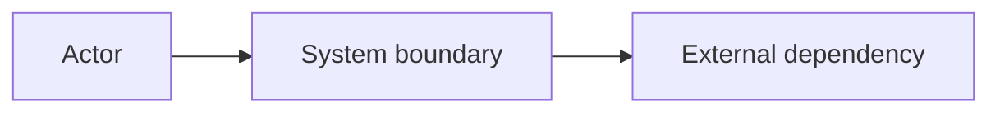

# [[FILL: Architecture or design topic]]

- **Document ID:** D#.# 
- **Status:** drafting
- **Scope:** system / subsystem / module
- **Related requirements and quality attributes:**
- **Related ADRs:**

## Purpose and architecture drivers
## Context and boundaries
## Responsibilities and ownership
## Proposed structure and communication
## Diagram

Caption: Explain the main boundary or flow. Source of truth: [[FILL: Relevant source-of-truth document IDs]].

## Contracts and interfaces
## Data ownership and lifecycle
## Runtime behavior and concurrency
## Failure modes and resilience
## Security and privacy
## Quality attributes and targets
## Observability and operations
## Alternatives and trade-offs
## Verification plan
## Open questions and risks
